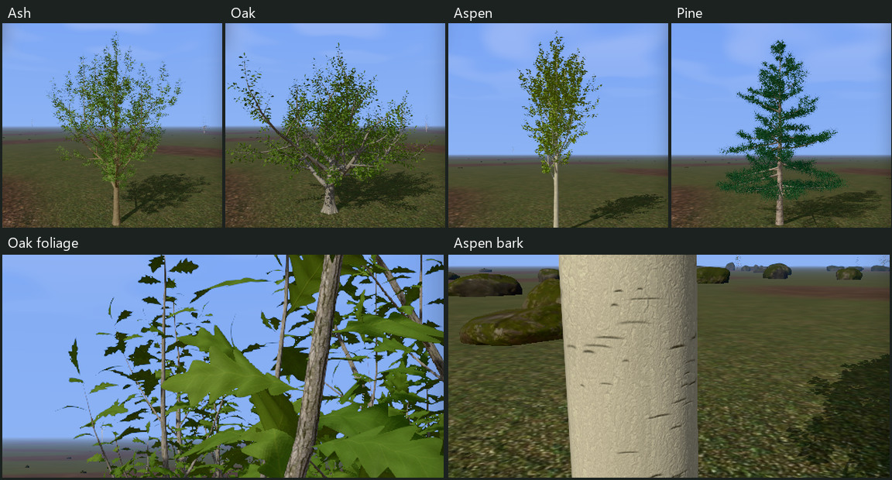
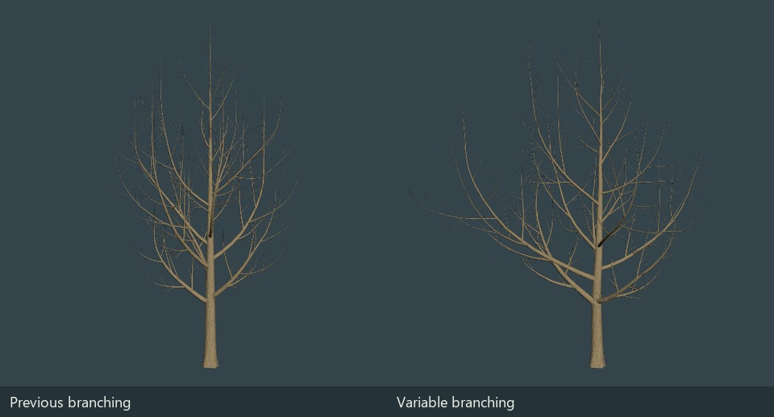
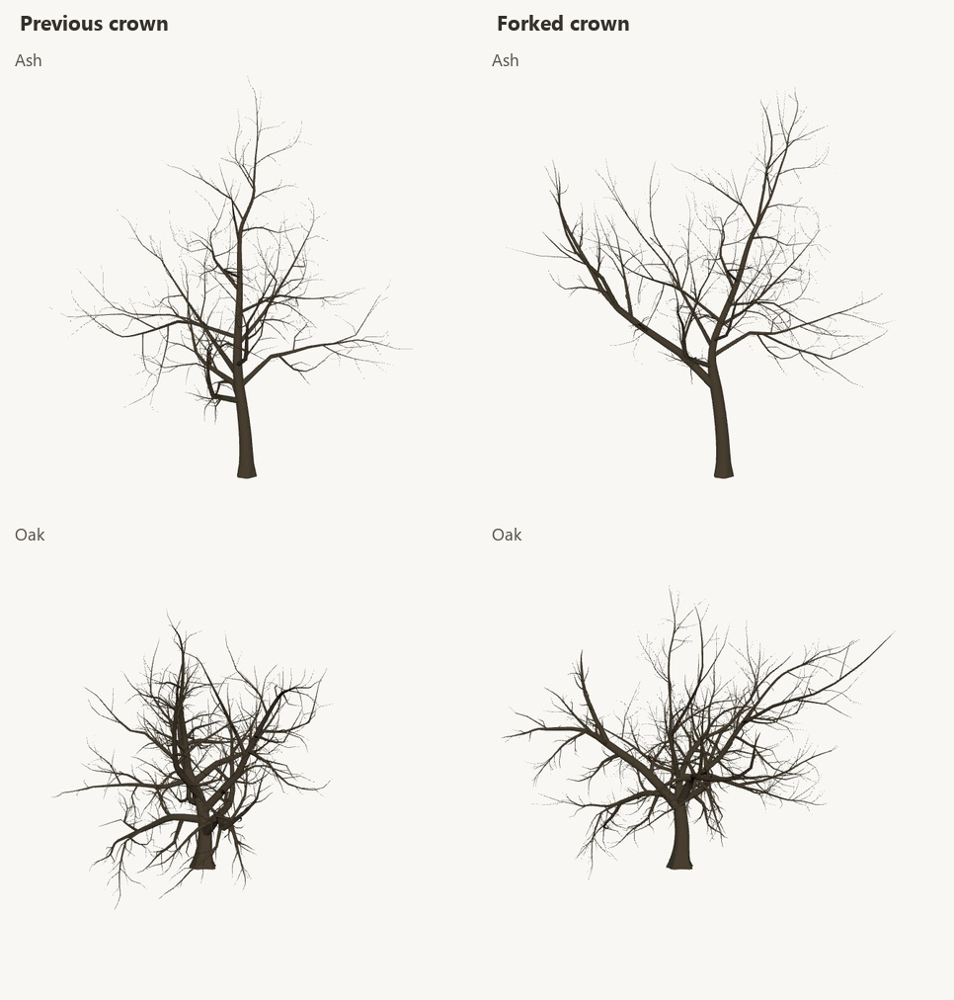
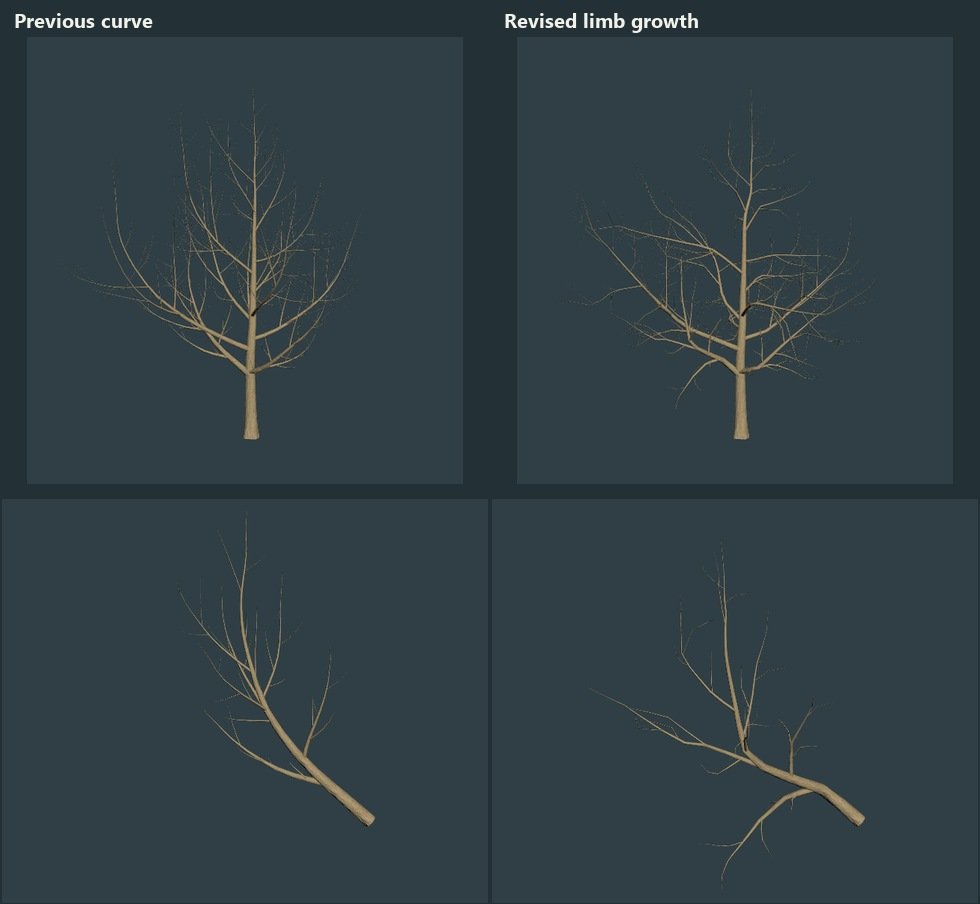
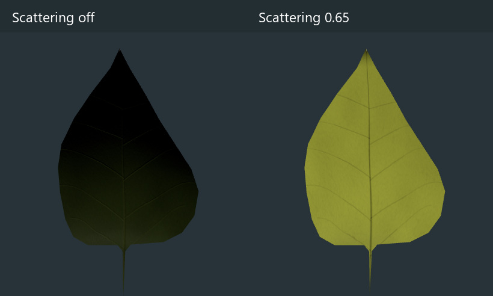
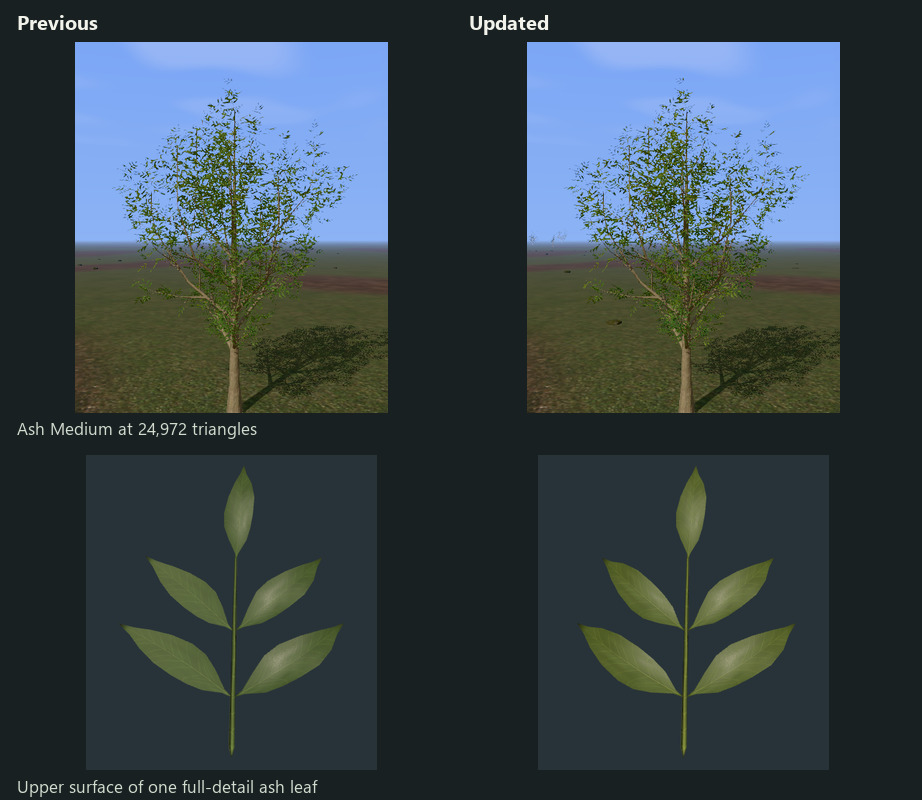
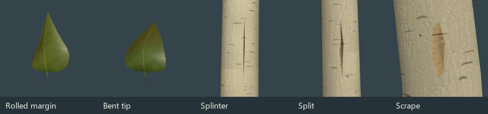
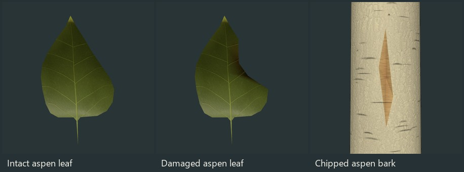
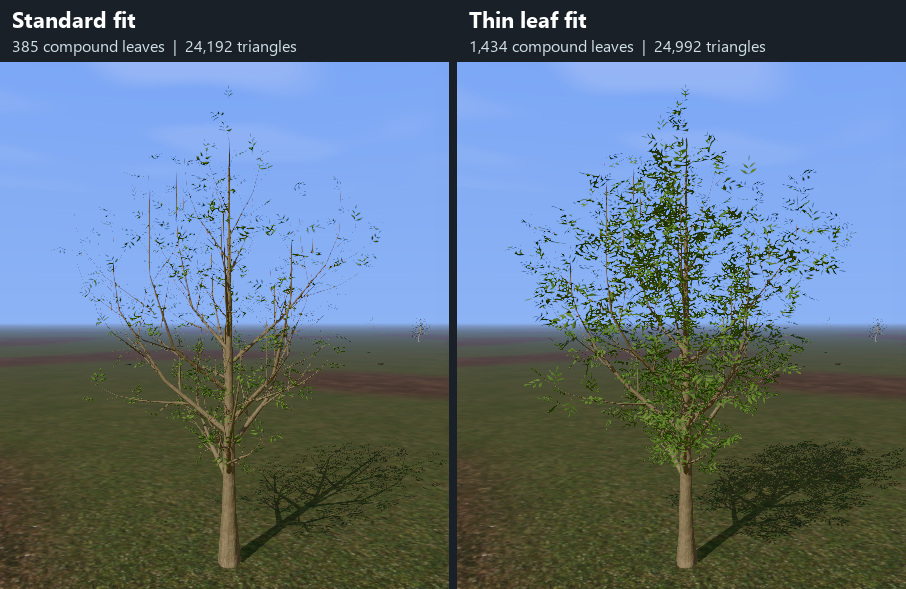
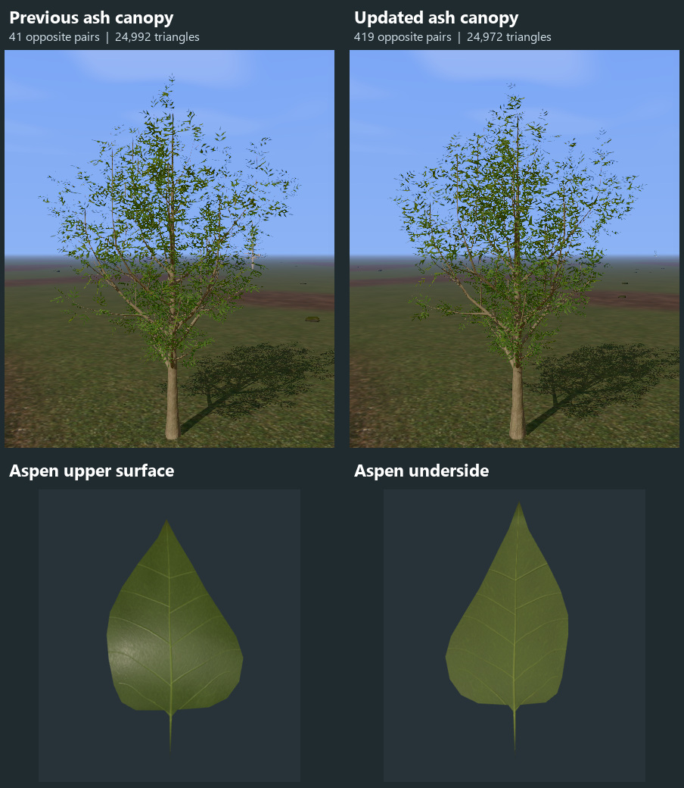

# EZ-Tree mesh leaf generator

A local edition of Daniel Greenheck's EZ-Tree. Oak has lobed blades, aspen has rounded blades, ash has paired leaflets on a stem, and pine has clusters of individual needles. All leaf silhouettes are modeled in opaque geometry. Each LOD can use closed blades or lightweight, two-sided blades.



## Run the editor

From this directory, run the following commands and open the local address printed by Vite.

```sh
npm ci
npm run dev
```

Choose a tree preset, then open **Leaves** to adjust leaf shape, density, size, angle, tint, and surface textures. Drag to orbit, scroll to zoom, and right-drag to pan. Double-click a leaf or trunk to inspect its surface. Double-click the background or use **Camera → Frame Entire Tree** to return to the canopy.

The tree, shrub, and trellis presets use metre-scale dimensions. Ash carries pairs of compound leaves, oak grows larger spreading limbs, aspen has a slender pale trunk, and pine branches grow in whorls with lateral sprays of needles. The updated growth model changes the shape produced by earlier seeds. The same seed and settings reproduce a tree within this version.

Preset foliage sizes use metres and include a modeled petiole or fascicle. Sizes are based on representative species: [ash](https://plants.ces.ncsu.edu/plants/fraxinus-americana/), [aspen](https://plants.ces.ncsu.edu/plants/populus-tremuloides/common-name/american-aspen/), [oak](https://plants.ces.ncsu.edu/plants/quercus-alba/), [pine](https://plants.ces.ncsu.edu/plants/pinus-strobus/common-name/northern-white-pine/), [ginkgo](https://plants.ces.ncsu.edu/plants/ginkgo-biloba/), [willow](https://web.uri.edu/wp-content/uploads/sites/2078/Salix-babylonica.pdf), and [sugar maple](https://plants.ces.ncsu.edu/plants/acer-saccharum/common-name/sugar-maple/). Actual plants vary. Smaller leaves need more geometry to fill a crown; the 25,000-triangle fit can appear sparse.

Branch growth transitions are eased and intermediate rings round the curves. Child branches and leaves attach to the same refined path. Reducing rings for a low LOD may make curves more angular again. Existing seeds produce different trees after these changes.

**Branches → Structure Variation** defaults to 0.75. It varies the gaps between forks and the length and girth of neighboring limbs. A broadleaf lateral can compete with the leader, while pine keeps its tiers.



**Branches → Forked Broadleaf Crown** is on by default for free-growing deciduous trees. The trunk divides into two substantial stems. The continuing stem tapers and turns away from its partner, and the larger limbs can divide again. Some outer shoots also carry a finer side twig with its own leaves. Disable the control to recover the previous crown for a seed. Pine whorls and trellis-trained trees use their own branching patterns.



**Branches → Limb Bends** controls the path each limb takes between forks. At the default of 0.85, a shoot can extend straight, dip or turn sideways, then continue along that heading. Some tips turn back toward the light. At zero, branches follow the previous smooth curves. The comparison shows the same seed with identical fork placement on the trunk and isolates its thickest lateral limb in the bottom row.



Each blade has root-to-tip UVs for 1024 × 1024 color, normal, roughness, and subsurface maps. The grayscale subsurface PNG stores a linear weight. Lighter tissue transmits more diffuse light, and the dark veins and midrib transmit less. Each species has its own map. In **Leaves**, enable **Surface Textures** and adjust **Subsurface Strength** from 0 to 1. The default is 0.65. The effect uses the existing mesh at every LOD.

Closed oak, aspen, and ash blades have a waxier upper surface and a paler, rougher underside with more pronounced vein relief. Their normal and roughness images contain two 1024 × 1024 panels sampled through a second UV set. Color and subsurface weight use the original blade UVs. Thin blades share the upper panel across their two visible faces. Pine uses its needle-specific maps.



**Leaves → Shoot Color Variation** gives leaves on a shoot a shared tint, with lighter, warmer growth toward the tip. It is enabled by default and uses the existing vertex colors in the editor and in GLB and USD exports. Each retained leaf keeps its tint across LODs.



Bark UVs follow branch length through every LOD. Bark normals follow the slope of each taper so narrowing twigs catch light along their length. To regenerate the supplied leaf and aspen bark maps, run `python scripts/bake_surfaces.py` with Pillow, NumPy, and SciPy installed.

**Leaves → Leaf Damage** defaults to 0.18. A blade can have a bitten margin, torn tip, dry rolled edge, or a crease that bends the tip while keeping its veins intact. Ash damage affects one leaflet, and individual pine needles can dry, kink or break. **Bark → Bark Chipping** defaults to 0.25 and adds narrow splits, splinters, and broader shallow scrapes to the trunk and thicker branches. Freshly exposed wood is warmer, while older wounds fade toward gray. Set either control to zero for a clean surface. Increasing a control reveals more damage at repeatable sites. Leaf wear uses existing triangles, and the fitter reserves 14 triangles per bark wound.





## Optimize a tree

Open **Mesh Optimization** and select the LOD you want to edit. **Fit to Budget** chooses blade resolution, leaf spacing, branch ring spacing, and branch sides for the triangle target. The status reports the actual count, including the trellis when visible. If the target falls below the supported minimum, the tool shows the smallest available result. Use the individual controls to tune the silhouette and inspect each level with the viewport's LOD buttons. **Reset This Level** restores its initial settings. **Save Preset** includes the three sets of mesh settings.

LOD0 defaults to **Full** for close-ups. LOD1 and LOD2 default to **Thin (denser canopy)**. You can override the blade detail on each level or click **Fit to Budget** to fit the selected level. Each thin ash leaf keeps its five individually textured leaflets and stem in 12 triangles. An oak blade uses 6 triangles, an aspen blade uses 4, and a five-needle pine cluster uses 10. Thin blades render from both sides and retain their surface maps. Full detail gives close-ups finer margins and modeled edge thickness.

The fitter keeps rings at branch bends and moves twig and leaf attachments with the simplified wood. When thinning foliage it compares projected leaf density with the full crown from four directions. Local quotas spread the retained leaves across shoots and reserve room for opposite ash pairs.

With the default branch and damage settings, the shipped Ash Medium seed has 2,243,026 triangles at full detail. At a 25,000-triangle target, the standard fit keeps 385 compound leaves in 24,696 total triangles. Thin blades keep 1,412 compound leaves in 25,000 total triangles. The fitter reserves a ring at a major fork whenever the branch has room for an interior ring. Both fits use one bark mesh and one foliage mesh. The older comparisons below were rendered with chipping, structure variation, limb bends, and forked crowns off.





## Export

| Export | Contents |
| --- | --- |
| GLB (Current Level) | Visible tree geometry, vertex colors, and embedded bark and foliage textures in one binary glTF file |
| USD (Current Level) | Standalone ASCII OpenUSD stage with indexed meshes, normals, UVs, vertex colors, and opaque preview materials. Bark uses its tint. |
| GLB LODs (ZIP) | One GLB for each of the three configured levels |
| USD + Textures (Current Level ZIP) | The selected USD mesh with its bark and foliage images, including the leaf subsurface weight PNG |
| USD LODs + Textures (ZIP) | Three USD stages referencing one shared set of bark and foliage images. Extract either textured ZIP with its directory structure intact. |

GLB embeds the scattering weight using `KHR_materials_diffuse_transmission`. Importers that support the extension apply it automatically. The textured USD ZIPs include a thin-walled MaterialX Standard Surface with its subsurface input connected, plus a universal USD Preview Surface for other viewers. To wire the mask in another engine, import `*_Subsurface.png` as linear data and multiply its red channel by the desired scattering strength. The plain USD export is texture-free.

The models use the tree's rest pose. Wind is animated in the browser preview.

## Library

Build this checkout with `npm run build:lib`. The original project and attribution are available at the end of this README.

# Usage

```js
// Create new instance
const tree = new Tree();

// Set parameters
tree.options.seed = 12345;
tree.options.branch.length[0] = 20;
tree.options.branch.levels = 3;

// Generate tree and add to your Three.js scene
tree.generate();
scene.add(tree);
```

Any time the tree parameters are changed, you must call `generate()` to regenerate the geometry.

## Levels of Detail (LODs)

For scenes with many trees, `generateLODs()` builds the tree at multiple levels of detail hosted in a `THREE.LOD` object inside the tree group. The renderer automatically switches levels based on camera distance. All levels are meshed from the same skeleton, so the tree's silhouette stays consistent across switches — distant levels just use fewer ring segments and fewer (but larger) leaves.

```js
const tree = new Tree();
tree.loadPreset('Ash Medium');
tree.generateLODs(); // instead of generate()
scene.add(tree);
```

The default levels switch at 100 and 250 units. You can set custom levels with `generateLODs()`.

```js
tree.generateLODs([
  { distance: 0, detail: {} }, // full detail
  {
    distance: 80,
    hysteresis: 0.05,
    detail: {
      sectionStride: 3,    // keep about one ring in three, favoring bends
      segmentFactor: 0.75, // reduce radial segments to 75% (min 3)
      leafStride: 2,       // keep every 2nd leaf...
      leafScale: 1.4,      // ...enlarged to preserve canopy coverage
      leafDetail: 'coarse', // simplify each solid blade
    },
  },
]);
```

LOD levels share one bark material and one leaf material per sidedness. `tree.update(time)` animates wind at every level. Calling `generate()` afterwards tears the LOD down and restores the single full-detail mesh pair (exporting a tree generated with `generateLODs()` to GLB includes every level).

If you have your own LOD or instancing system, `tree.createGeometry(detail)` returns raw `{ branches, leaves }` `BufferGeometry` pairs at any detail level without touching the tree's own meshes. Use `THREE.DoubleSide` on your leaf material when `leaves.userData.doubleSided` is true. Read `leaves.userData.leafSites` for the retained count.

To fit a specific budget from code, call `tree.fitTriangleBudget(25000)` for closed blades or `tree.fitTriangleBudget(25000, { thinLeaves: true })` for thin blades. Pass the returned settings to `tree.createGeometry(detail)` or `tree.generate(detail)`. Run the regression checks with `npm test`.

# Running App with Docker

```bash
docker compose build
docker compose up -d
```

# Tree Parameters

The `TreeOptions` class defines an options object that controls various parameters of a procedurally generated tree. Each property of this object allows for customization of the tree's appearance, including bark, branches, and leaves. Below is a detailed explanation of each property of the `TreeOptions` object.

## General Properties

- **`seed`**: Sets the initial value for random generation, ensuring consistent tree generation when using the same seed.
- **`type`**: Defines the type of the tree, which can be set to one of the options from the `TreeType` enumeration (e.g., `TreeType.Deciduous`).

## Bark Parameters

The `bark` object controls the appearance and properties of the tree trunk.

- **`type`**: Specifies the type of bark texture to use, selected from the `BarkType` enumeration (e.g., `BarkType.Oak`).
- **`tint`**: Determines the color tint applied to the bark, defined as a hexadecimal color value (e.g., `0xffffff` for white).
- **`flatShading`**: Boolean property indicating whether to use flat shading (`true`) or smooth shading (`false`) for the bark.
- **`textured`**: Boolean value that indicates if a texture is applied to the bark (`true` or `false`).
- **`textureScale`**: Controls the scale of the bark texture in both the `x` and `y` axes. It is an object with properties `x` and `y` to define the scaling factors.

## Branch Parameters

The `branch` object defines parameters for the trunk and branch levels of the tree.

- **`levels`**: Number of recursive branch levels. Setting this to `0` creates only the trunk, while higher values add more branches.
- **`angle`**: Defines the angle, in degrees, at which child branches grow relative to their parent branch. This is specified separately for each level.
- **`children`**: Specifies the number of child branches at each level, with the index (`0`, `1`, `2`, etc.) representing the level.
- **`force`**: Represents an external directional force encouraging tree growth, defined by `direction` (a vector object `{ x, y, z }`) and `strength` (a numeric value).
- **`gnarliness`**: Defines how twisted or curled each branch level should be, specified for each level.
- **`length`**: Length of the branches at each level. This is an object with keys representing each level.
- **`radius`**: Radius (or thickness) of the branches at each level.
- **`sections`**: Number of segments along the length of each branch level, controlling the resolution of the branch mesh.
- **`segments`**: Number of radial segments that make up each branch, with a higher value resulting in a smoother cylinder.
- **`start`**: Specifies where along the parent branch (as a fraction from `0` to `1`) the child branches should start forming.
- **`taper`**: Controls the tapering of the branches at each level. A value between `0` and `1` defines the reduction in radius from base to tip.
- **`twist`**: Defines the amount of twisting applied to each branch level.

## Leaf Parameters

The `leaves` object defines properties that control the appearance and placement of leaves.

- `type` chooses the oak, aspen, ash, or pine mesh.
- **`angle`**: Defines the angle of the leaves relative to the parent branch, in degrees.
- **`count`**: Number of leaves to generate.
- **`start`**: Specifies where along the length of the branch (as a value between `0` and `1`) leaves should start growing.
- **`size`**: Size of the leaves, represented as a numeric value.
- **`sizeVariance`**: Specifies how much variance in size each leaf instance should have, making the leaves look more natural.
- **`tint`**: Tint color applied to the leaves, defined as a hexadecimal color value (e.g., `0xffffff` for white).
- `roundedNormals` controls smooth shading of the leaf surface in the preview.

Based on [EZ-Tree by Daniel Greenheck](https://github.com/dgreenheck/ez-tree), distributed under the [MIT license](LICENSE).
